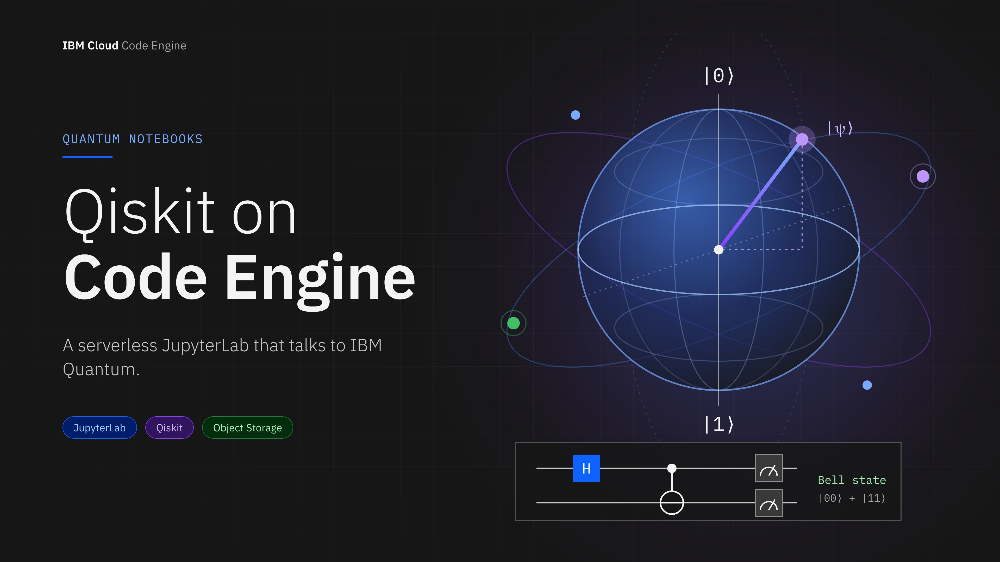
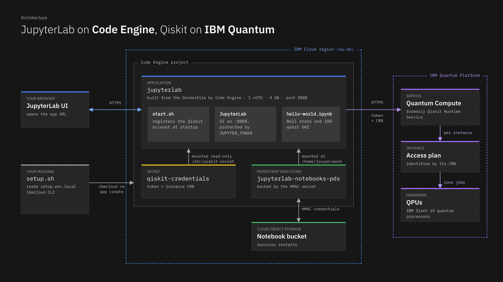
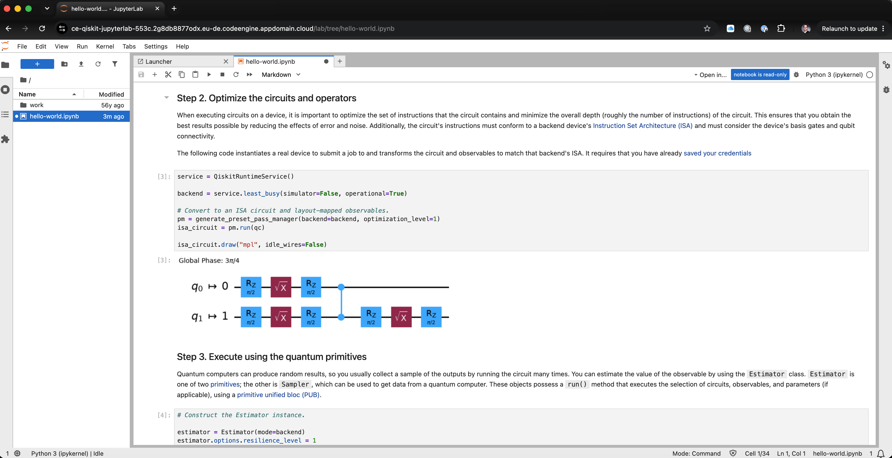

## Introduction

Quantum computing has an unusual shape as a workload. The quantum part runs on a quantum processing unit (QPU) that IBM operates for you. Everything around it is ordinary classical computing: you write a circuit, optimize it for a specific device, submit a job, wait in a queue, and post-process the results. That classical part usually lives in a Jupyter notebook.

The notebook is where things get awkward. It runs on your laptop, so the credentials sit on your laptop, the job you submitted before closing the lid is easy to lose track of, and sharing a working setup with a colleague means walking them through a Python environment.

[IBM Cloud Code Engine](https://www.ibm.com/products/code-engine) is IBM's fully managed, serverless platform for running containerized workloads. You hand it source code or a container image. It builds, deploys, secures, and scales the workload, and you do not touch servers or clusters. That is a good fit for the classical half of a quantum workflow: a small, always-reachable environment next to the quantum service, with nothing to patch and nothing to operate.

In this post, you will deploy **JupyterLab with Qiskit as a Code Engine application**. Your notebooks are stored in IBM Cloud Object Storage so they survive restarts, your IBM Quantum credentials are injected as a Code Engine secret, and a single script does all the provisioning.



## Why Code Engine for Quantum Notebooks?

[IBM Quantum](https://quantum.cloud.ibm.com/docs/en/guides/compute-services) is made of a few services, and the part you talk to from a notebook is **IBM Quantum Compute**, formerly called the Qiskit Runtime Service. The `qiskit-ibm-runtime` package is its client. It runs your circuits on IBM hardware and can apply error suppression and error mitigation to return higher-quality results. You can submit work as a single **Job**, as a **Session** for iterative workloads, or as a **Batch** of jobs for parallel processing. Open Plan users cannot submit session jobs.

Each of those jobs waits in a queue on the QPU side, so the notebook that submitted it is mostly waiting. Here is how the Code Engine value proposition maps onto that pattern.

### No infrastructure to manage

Code Engine builds the container image from the `Dockerfile` in your folder, pushes it to a registry it manages for you, and runs it with an HTTPS endpoint. There is no Docker build on your laptop, no registry to set up, and no cluster to operate. You only provide the notebook environment.

### Credentials stay out of the notebook

Your IBM Quantum API key is a secret. In this setup it is stored as a Code Engine **secret** and mounted read-only into the container. At startup the container registers it with Qiskit, and notebook cells simply call `QiskitRuntimeService()` without arguments. The key never appears in a notebook, a Git repository, or a shared screen.

### A notebook that is always there

The app is reachable from any browser, so you can start a job from your office, close the tab, and check the result from another machine. The hello-world notebook prints a job ID so you can retrieve results later, and the cloud-hosted notebook gives you a stable place to do that. For long-running quantum-classical workloads, [Qiskit Serverless](https://quantum.cloud.ibm.com/docs/en/guides/compute-services) also provides tools for persisting workloads in the cloud, even if your laptop is turned off.

### Your work survives restarts

Containers are disposable by design. To keep notebooks, the app mounts an IBM Cloud Object Storage bucket through a Code Engine **persistent data store** at `/home/jovyan/work`. Files saved there persist across restarts and redeployments.

### Pay for what the platform uses

Code Engine bills for the resources your app consumes, and it can scale to zero. JupyterLab is a stateful application, so this tutorial pins the app to one instance (`--min-scale 1 --max-scale 1`) to keep your kernels alive between visits, with a scale-down delay of 10 minutes. If you would rather save cost and accept that running kernels are lost, change the minimum to zero:

```bash
ibmcloud ce app update --name <app-name> --min-scale 0
```

Your notebooks are safe either way, because they live in the bucket.

## How It Works



The architecture has three parts: your machine, the Code Engine project, and IBM Quantum.

**Your machine** only runs `setup.sh`, which uses the `ibmcloud` CLI to provision everything. Nothing is installed in the cloud by hand.

**The Code Engine project** is the container for the workload, and it lives in one IBM Cloud region. Inside it:

- The **application** is built from the `Dockerfile`. The image extends the official `quay.io/jupyter/base-notebook`, runs as the non-root user `jovyan`, installs `qiskit-ibm-runtime` and `matplotlib`, and starts through `start.sh`. It listens on port 8888 with 1 vCPU and 4 GB of memory.
- The **secret** holds your IBM Quantum token and instance CRN as a JSON file. It is mounted read-only at `/etc/qiskit-secret/`.
- The **persistent data store** points at an Object Storage bucket, using HMAC credentials that the script generates and stores as another secret. It is mounted at `/home/jovyan/work`.

**IBM Quantum** is the external service. Your notebook calls IBM Quantum Compute over HTTPS with your token and the CRN of the instance you want to use. IBM Quantum Platform is where instances live, and each instance has its own Cloud Resource Name (CRN), which is required to submit workloads to the available QPUs.

When the container starts, `start.sh` does two things. First, it reads the mounted secret and calls `QiskitRuntimeService.save_account(...)`, so every notebook can create a service client with no arguments. Second, it launches JupyterLab.

### How JupyterLab shows up as the application

Code Engine applications get an HTTPS endpoint, and the platform routes traffic to the port your container listens on. Because JupyterLab is a web server, it simply is the application: the URL that Code Engine prints is the JupyterLab login page. You open it, enter your Jupyter token, and you are in a full notebook environment with `hello-world.ipynb` in the file browser and a `work` folder backed by Object Storage. A screenshot of the running app follows in Step 5.

## Prerequisites

You will need:

- An **IBM Cloud account** with Code Engine and Cloud Object Storage available.
- The [IBM Cloud CLI](https://cloud.ibm.com/docs/cli) (`ibmcloud`) with two plugins installed:

  ```bash
  ibmcloud plugin install code-engine
  ibmcloud plugin install cloud-object-storage
  ```

- An **IBM Quantum** account, an API key, and an instance CRN. The next section shows how to get them.

## Step 1: Onboard to IBM Quantum

1. Go to [IBM Quantum Platform](https://quantum.cloud.ibm.com/) to log in or create an account.
2. Generate your API key (also called an API token) on the [dashboard](https://quantum.cloud.ibm.com/), then copy it to a secure location.
3. Go to the [Instances](https://quantum.cloud.ibm.com/instances) page and find the instance you want to use. Hover over its CRN and click to copy it.

You now have two values: the **API key** and the **instance CRN**.


**Note:** Treat the API key like a password. Do not paste it into a notebook, a chat, or a commit. The setup below stores it only in a local file that is excluded from Git and from the Code Engine build, and in a Code Engine secret.


## Step 2: Get the code

The sample lives in the [Code Engine sample repository](https://github.com/IBM/CodeEngine):

```bash
git clone https://github.com/IBM/CodeEngine
cd CodeEngine/quantum/qiskit-jupyter-app
```

The folder contains the following files:

| File | Purpose |
|---|---|
| `Dockerfile` | Container image: Jupyter base image plus Qiskit |
| `start.sh` | Registers the Qiskit account, then starts JupyterLab |
| `hello-world.ipynb` | A Bell state and a 100-qubit GHZ state example |
| `setup.env` | Configuration template |
| `setup.sh` | Idempotent provisioning script |

## Step 3: Create `setup.env.local`

`setup.sh` reads its configuration from a file called `setup.env.local`. Start from the template:

```bash
cp setup.env setup.env.local
```

Open `setup.env.local` and replace every `<placeholder>`. The file is listed in `.gitignore` and `.ceignore`, so it is neither committed nor uploaded as part of the build.

The file has only a handful of variables:

| Variable | What to put there |
|---|---|
| `IBMCLOUD_API_KEY` | Optional and commented out by default. An IBM Cloud API key from [Manage, API keys](https://cloud.ibm.com/iam/apikeys). Without it, the script runs `ibmcloud login --sso` and asks you for a one-time passcode |
| `IBMCLOUD_REGION` | The region for all resources. Defaults to `eu-de`; for example `us-south` |
| `NAME_PREFIX` | The prefix for all resource names. Defaults to `ce-qiskit-jupyterlab` |
| `QISKIT_IBM_TOKEN` | The IBM Quantum API key from Step 1 |
| `QISKIT_IBM_INSTANCE` | The instance CRN from Step 1 |
| `JUPYTER_TOKEN` | The password for the JupyterLab login page |

For `JUPYTER_TOKEN`, generate a long random value rather than choosing one:

```bash
openssl rand -hex 32
```

Here is how the quantum-related part of the file looks, with placeholders:

```bash
QISKIT_IBM_TOKEN="<your-ibm-quantum-api-key>"
QISKIT_IBM_INSTANCE="<your-ibm-quantum-instance-crn>"
JUPYTER_TOKEN="<output-of-openssl-rand-hex-32>"
```

`IBMCLOUD_REGION` and `NAME_PREFIX` use the shell value if you set one, so you can also pick them on the command line, for example `NAME_PREFIX=my-lab ./setup.sh`.

### Where the resource names come from

You do not have to name anything yourself. The script derives every cloud resource name from `NAME_PREFIX` plus a stable 4-character suffix, which is a hash of your IBM Cloud account ID and the prefix. With the default prefix, the names look like this (the suffix `3fa9` is an example):

| Resource | Name |
|---|---|
| Resource group, Code Engine project, application | `ce-qiskit-jupyterlab-3fa9` |
| Object Storage instance | `ce-qiskit-jupyterlab-3fa9-cos` |
| Object Storage bucket | `ce-qiskit-jupyterlab-3fa9-notebooks` |
| Persistent data store | `ce-qiskit-jupyterlab-3fa9-notebooks-pds` |
| Secrets | `ce-qiskit-jupyterlab-3fa9-qiskit`, `ce-qiskit-jupyterlab-3fa9-cos-hmac` |

The suffix keeps the globally unique bucket name from colliding with other accounts, and because it is stable, running the script again reuses the same resources. If you need a specific name, export the variable in your shell before running the script, for example `CE_PROJECT_NAME=my-project ./setup.sh`. The same works for `IBMCLOUD_RESOURCE_GROUP_NAME`, `CE_APP_NAME`, `COS_BUCKET_NAME` and the other derived names. You also do not need to copy any Object Storage keys: the script creates the credential with HMAC enabled and reads the keys at run time.

## Step 4: Run the setup

```bash
./setup.sh
```

The script loads `setup.env.local` from the current directory. To use a different file, pass it through an environment variable:

```bash
ENV_FILE=my-other.env ./setup.sh
```

It validates that the required variables are set, logs in, prints the resource names it derived, and then provisions the following resources in order:

1. Creates the resource group if needed.
2. Creates or reuses the Object Storage instance.
3. Creates a service credential with HMAC enabled and extracts the keys.
4. Creates or reuses the bucket.
5. Creates or reuses the Code Engine project.
6. Stores the HMAC keys as a Code Engine secret.
7. Creates the persistent data store that links the bucket to Code Engine.
8. Stores your Qiskit token and CRN as a Code Engine secret.
9. Builds the image from the local `Dockerfile` and deploys the application, with the bucket mounted at `/home/jovyan/work`, the secret mounted at `/etc/qiskit-secret/`, and `JUPYTER_TOKEN` set as an environment variable.
10. Prints the application URL.

Every step checks whether the resource already exists before creating it, so it is safe to run `./setup.sh` again. When you change a notebook dependency in the `Dockerfile`, re-running the script updates the application and triggers a new build.

The first run takes a few minutes because Code Engine builds the image from source.

## Step 5: Open JupyterLab and run your first circuit

Open the URL printed at the end of the script and enter your `JUPYTER_TOKEN` when prompted. JupyterLab opens, and `hello-world.ipynb` is ready to run.

The notebook follows the four Qiskit patterns steps:

1. **Map** the problem to a quantum circuit, a Bell state that entangles two qubits.
2. **Optimize** the circuit for a specific device by transpiling it for the least busy backend.
3. **Execute** it with the `Estimator` primitive and 5,000 shots.
4. **Analyze** the expectation values.

The cell that connects to IBM Quantum shows what the startup script made possible:

```python
from qiskit_ibm_runtime import QiskitRuntimeService

service = QiskitRuntimeService()                  # credentials come from the mounted secret
backend = service.least_busy(simulator=False, operational=True)
```

There is no token and no CRN in the notebook. The screenshot below shows JupyterLab served by the Code Engine application, with `hello-world.ipynb` and the `work` folder in the file browser. The open cell is Step 2: it picks the least busy backend and transpiles the Bell state circuit for it. The circuit drawn below the cell has been rewritten into the native gates of the selected device (`Rz`, `√X` and a two-qubit gate) and mapped onto its physical qubits.



After the Bell state, the notebook scales up to a 100-qubit GHZ state, a circuit of the size people call utility scale, and plots how the correlation between distant qubits decays because of hardware noise.


**Note:** Jobs on real hardware wait in the IBM Quantum queue. The notebook prints a job ID when it submits, so you can come back and retrieve the result later. To iterate without waiting, use the local testing mode with a fake backend, as described in the notebook.


`hello-world.ipynb` is baked into the image in the home directory. To keep your own notebooks, save them in the `work` folder, which is the mounted bucket. Everything in `work` is written to Object Storage and is still there after a restart.

## Operating the App

Check the application and open its logs when something looks wrong. The application name is the one printed by `setup.sh`:

```bash
ibmcloud ce app get --name <app-name>
ibmcloud ce app logs --name <app-name>
```

The logs include the `[start]` lines from `start.sh`, which tell you whether the Qiskit account was registered.

To rotate your IBM Quantum key, change `QISKIT_IBM_TOKEN` in `setup.env.local` and run `./setup.sh` again. The script updates the secret and the application.

When you are done, delete the Code Engine project and the Object Storage resources from the IBM Cloud console, or keep them around, since notebooks stay in your bucket.

## Conclusion

Quantum programs split cleanly into a part that runs on a QPU and a part that runs around it. Code Engine is a good home for the second part. You get a managed, HTTPS-reachable notebook environment that is built from your own `Dockerfile`, holds your credentials in a secret, and keeps your work in Object Storage. You provide a config file and run one script.

From here you can make it your own. Add Python packages to the `Dockerfile`, bring in the other Qiskit tutorials for VQE and QAOA, or mount a bigger bucket for datasets. The same pattern works for any browser-based tool that needs a stable home next to a cloud service.

## Resources

- [IBM Cloud Code Engine](https://www.ibm.com/products/code-engine)
- [Code Engine documentation](https://cloud.ibm.com/docs/codeengine)
- [Code Engine sample repository](https://github.com/IBM/CodeEngine), including `quantum/qiskit-jupyter-app`
- [Introduction to IBM Quantum services](https://quantum.cloud.ibm.com/docs/en/guides/compute-services)
- [IBM Quantum Platform](https://quantum.cloud.ibm.com/)
- [IBM Quantum instances](https://quantum.cloud.ibm.com/instances)
- [IBM Cloud CLI](https://cloud.ibm.com/docs/cli)
